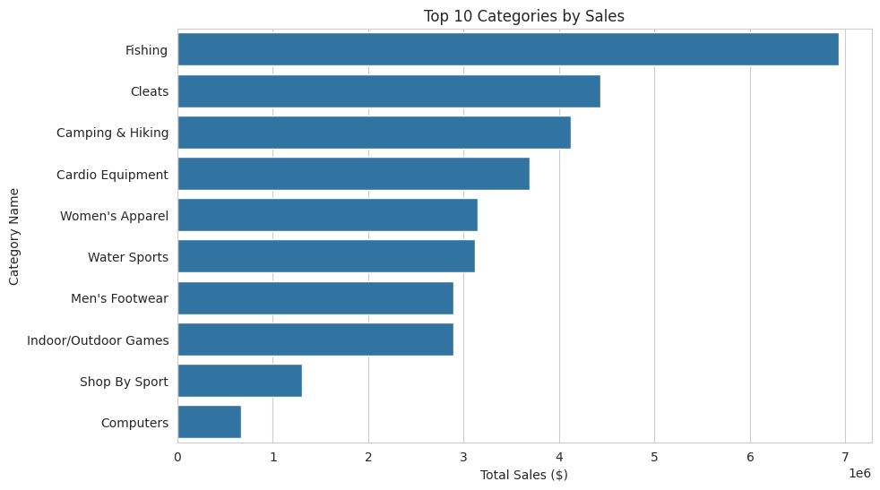
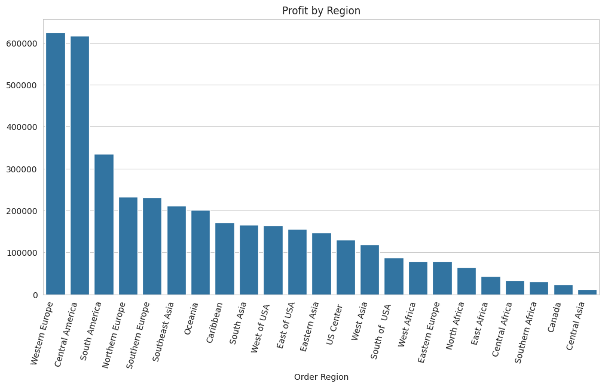
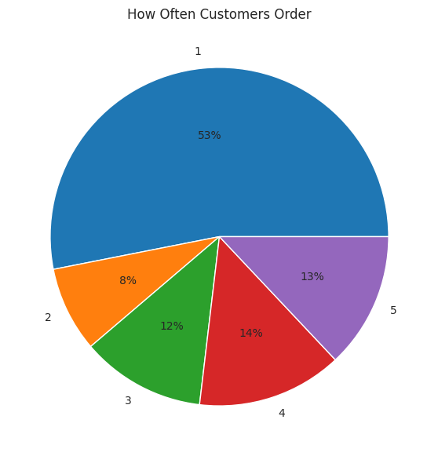
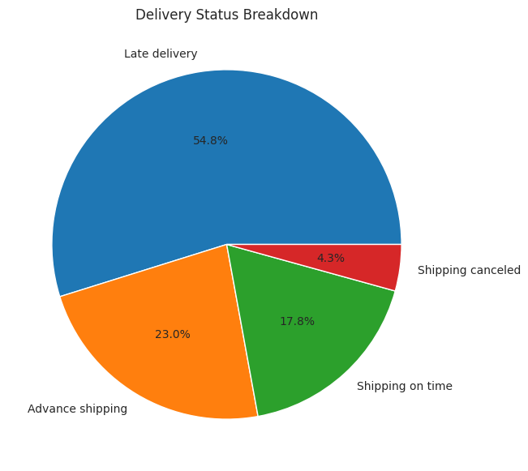
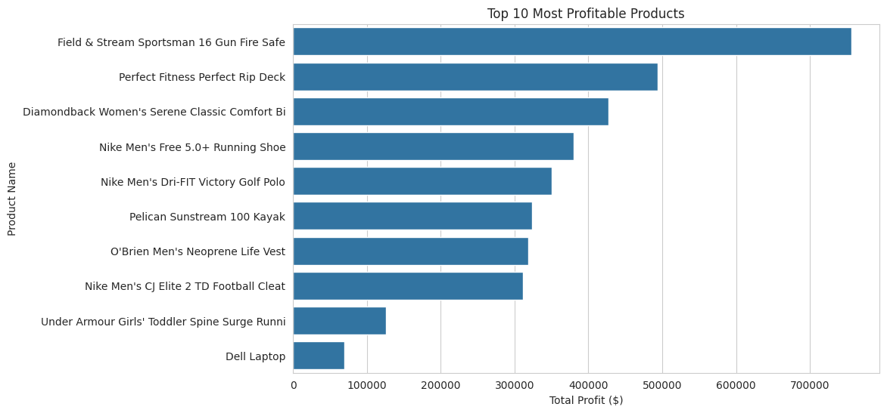
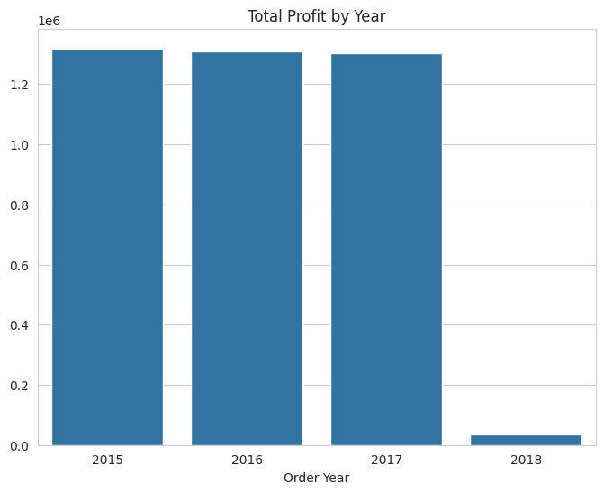
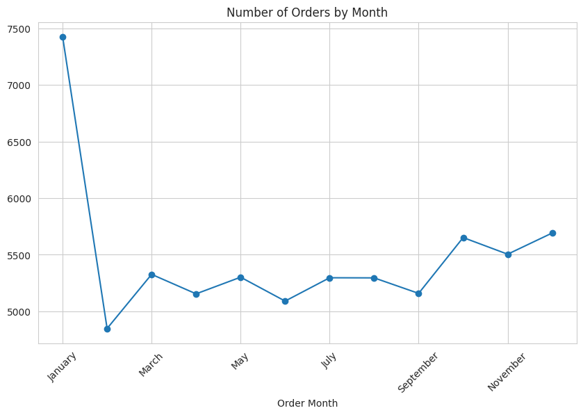
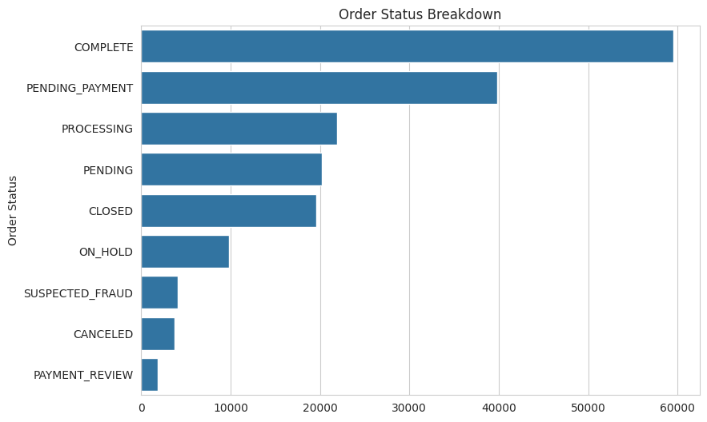

# DataCo Supply Chain Sales Analysis

An end-to-end exploratory analysis of the **DataCo Supply Chain Dataset** (Kaggle), covering sales, profitability, customers, shipping performance and cancellations. The project has two parts:

1. **Python analysis** (`DataCo_Analysis.py`): data cleaning, feature engineering, aggregate statistics and 8 charts using pandas, matplotlib and seaborn.
2. **Business report** (`Project report DataCo.pdf`): an 18-page write-up with pivot-table insights and a Power BI dashboard.

---

## Table of contents

- [Dataset](#dataset)
- [Repository structure](#repository-structure)
- [Tech stack](#tech-stack)
- [What the analysis does](#what-the-analysis-does)
- [Key findings](#key-findings)
- [Charts](#charts)
- [Business report and dashboard](#business-report-and-dashboard)
- [How to run](#how-to-run)
- [Notes and limitations](#notes-and-limitations)
- [Acknowledgements](#acknowledgements)

---

## Dataset

| Property | Value |
|---|---|
| Source | [DataCo Smart Supply Chain for Big Data Analysis](https://www.kaggle.com/) on Kaggle |
| File | `DataCo SupplyChain Dataset.csv` (about 96 MB, `latin1` encoding) |
| Size | 180,519 rows x 53 columns (one row per order line item) |
| Unique orders / customers | 65,752 / 20,652 |
| Order dates | 1 Jan 2015 to 31 Jan 2018 |
| Coverage | 5 markets, 23 order regions, 164 countries, 50 product categories, 118 products |
| Customer segments | Consumer, Corporate, Home Office |
| Shipping modes | Standard Class, Second Class, First Class, Same Day |

The columns span order details, customer information, product data, sales and profit metrics, and shipping logistics (scheduled vs. actual shipping days, delivery status, late-delivery risk).

## Repository structure

```
DataCo-Sales-Analysis/
├── Charts/                           # 8 PNG charts produced by the script
│   ├── 01_top_categories.png
│   ├── 02_profit_by_region.png
│   ├── 03_order_frequency.png
│   ├── 04_delivery_status.png
│   ├── 05_top_products.png
│   ├── 06_profit_by_year.png
│   ├── 07_orders_by_month.png
│   └── 08_order_status.png
├── DataCo SupplyChain Dataset.csv    # raw dataset
├── DataCo_Analysis.py                # cleaning, analysis and charting script
├── Project report DataCo.pdf         # written report with Power BI dashboard
├── .gitignore
└── README.md
```

## Tech stack

- **Python 3** with `pandas`, `matplotlib`, `seaborn`
- **Excel** (pivot tables) and **Power BI** (dashboard), as described in the PDF report

## What the analysis does

**1. Cleaning**
- Loads the CSV with `latin1` encoding and reports shape and missing values (only `Customer Lname`, `Customer Zipcode`, `Order Zipcode` and `Product Description` have gaps).
- Drops 8 columns that are empty, personal or not useful for analysis: `Product Description`, `Customer Email`, `Customer Password`, `Customer Fname`, `Customer Lname`, `Customer Street`, `Product Image`, `Order Zipcode` (53 columns down to 45).
- Parses the order and shipping dates, fills missing `Customer Zipcode` with `0`, and removes duplicate rows (none were found).

**2. Feature engineering**
- `Order Year`, `Order Month`
- `Delivery Delay` = actual shipping days minus scheduled shipping days
- `Is Canceled` = order status is `CANCELED` or `SUSPECTED_FRAUD`

**3. Analysis**
- Sales and profit by category, region and product
- Top customers by spending and order-frequency distribution
- Delivery status breakdown and average delay by shipping mode
- Correlation between discount rate and profit
- Profit by year, orders by month, order status mix and cancellation rate

**4. Output**
- Prints a summary of results and an eight-point "Key insights" block to the console
- Saves eight charts as PNG files

## Key findings

Figures below come from running `DataCo_Analysis.py` on the CSV in this repository. "Profit" is the sum of `Order Profit Per Order`.

| Topic | Result |
|---|---|
| Top category by sales | **Fishing**, about $6.93M, followed by Cleats ($4.43M) and Camping & Hiking ($4.12M) |
| Top regions by profit | **Western Europe** (about $625K), Central America ($616K), South America ($335K) |
| Most profitable product | **Field & Stream Sportsman 16 Gun Fire Safe**, about $756K |
| Least profitable category | Strength Training |
| Top customer | Customer ID **791**, about $10.5K in sales |
| Delivery status | Late 54.8%, advance shipping 23.0%, on time 17.8%, canceled shipping 4.3% |
| Average delay by shipping mode | Second Class +1.99 days, First Class +1.00, Same Day +0.48, Standard Class about 0 |
| Discount vs. profit | Correlation of **-0.02**, effectively no relationship |
| Cancellation rate | **4.30%** (canceled plus suspected fraud) |
| Profit by year | 2015: $1.32M, 2016: $1.31M, 2017: $1.30M (2018 contains January only) |
| Busiest month for orders | January |

Takeaways:

- Sales are concentrated in a handful of categories, led by Fishing, with a long tail of very small ones.
- Late delivery is the main operational problem. The faster-sounding modes (First Class, Second Class) are the ones that run behind schedule on average, while Standard Class meets its schedule.
- Discounting does not visibly drive profit in this data, so deep discounts are worth questioning.
- Profit was essentially flat from 2015 to 2017.

## Charts

| | |
|---|---|
|  |  |
| Top 10 categories by sales | Profit by region |
|  |  |
| How often customers order | Delivery status breakdown |
|  |  |
| Top 10 most profitable products | Total profit by year |
|  |  |
| Orders by month | Order status breakdown |

## Business report and dashboard

`Project report DataCo.pdf` walks through the project as a business analyst would: objectives, data preparation, KPIs and six insight sections (sales performance, customer segmentation, shipping and delivery, profitability, order trends, returns and cancellations), ending with a Power BI dashboard.

Headline dashboard KPIs from the report: **Total Sales 19.5M, Total Profit 6.7M, Average Profit 45.8, Average Delivery 5 days, Total Orders 145.6K.** Other points it makes:

- Western Europe is the most profitable region, and the United States leads by country.
- Fishing is the most demanded category; Field & Stream Sportsman 16 Gun Fire Safe is the top product.
- No relationship between discount level and profit.
- About 41% of orders arrive late and about 15% are canceled.
- Customer ID 2641 is the most valuable customer by spend.

## How to run

1. **Clone the repository**

   ```bash
   git clone https://github.com/PramodNimare111/DataCo-Sales-Analysis.git
   cd DataCo-Sales-Analysis
   ```

2. **Install dependencies**

   ```bash
   pip install pandas matplotlib seaborn
   ```

3. **Point the script at the CSV.** The script currently reads the file from a hard-coded path:

   ```python
   df = pd.read_csv("/mnt/user-data/uploads/DataCoSupplyChainDataset.csv", encoding="latin1")
   ```

   Change it to the file in this repository:

   ```python
   df = pd.read_csv("DataCo SupplyChain Dataset.csv", encoding="latin1")
   ```

4. **Run it**

   ```bash
   python DataCo_Analysis.py
   ```

   Results print to the console and the charts are written to a `charts/` folder.

## Notes and limitations

- **Two sets of numbers.** The Python results (from the CSV in this repo) and the PDF report (built with Excel and Power BI) do not match one-to-one. Totals, order counts, delivery percentages and the best profit year differ, so the two are reported separately above. Treat each as correct for its own workflow, and align them before quoting figures side by side.
- **Case-sensitive folders.** The script saves to `charts/` while the committed folder is `Charts/`. This makes no difference on Windows or macOS, but on Linux they are different folders.
- **Partial final year.** The data ends on 31 Jan 2018, so 2018 totals are not comparable with full years.
- **Cancellation definition.** `Is Canceled` counts both `CANCELED` and `SUSPECTED_FRAUD` orders.
- **Profit metric.** Profit is summed per order line, so it is not a true margin figure.

## Acknowledgements

Dataset: *DataCo Smart Supply Chain for Big Data Analysis* on [Kaggle](https://www.kaggle.com/). Project by [PramodNimare111](https://github.com/PramodNimare111).
